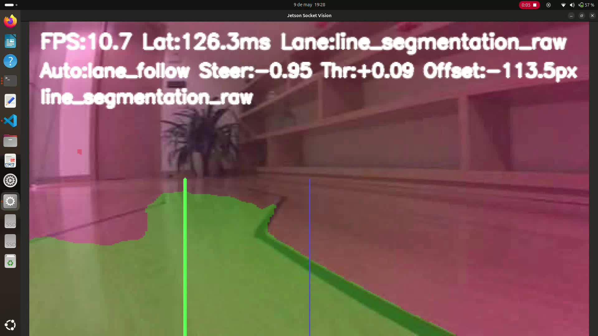
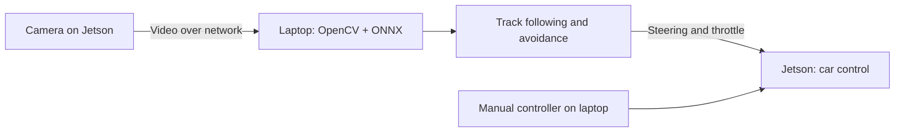

# Jetson Racer

[Español](README.md) · **English**

A vision-driven prototype for a Jetson Nano car: it segments the track and obstacles, computes steering and throttle, and can be driven manually from a laptop.

**Python · OpenCV · PyTorch · ONNX · Jetson Nano**

[Demos](https://github.com/R2DeezNuts/jetson-racer/releases) · [Presentation (Spanish)](docs/Presentaci%C3%B3nTFM-1.pdf) · [Proposal (Spanish)](docs/PropostaTFM_JuanJosePradoNeira_JavierRegoBargos.pdf) · [Training](circuito_segmentation/README.md) · [Portfolio](https://r2deeznuts.github.io/)



*A frame from one of the test recordings. The figures on screen belong to that moment; they are not a benchmark.*

## What it does

The project covers dataset preparation, training a U-Net with two outputs (track and obstacles), export to ONNX, and the perception, communication and control that run the car.

The Jetson captures the video and drives the steering and the motor. **Inference and the driving commands run on the laptop.** You can switch between automatic control and a manual controller, and see the masks and the computed commands.



## Results and limits

An integrated test ran video capture, segmentation, box detection and commands to the car. There are [test videos](https://github.com/R2DeezNuts/jetson-racer/releases) and a [presentation](docs/Presentaci%C3%B3nTFM-1.pdf) (in Spanish) with the results and limitations.

The camera and the Jetson–laptop–Jetson round trip latency limit the control. There is no formal measurement of FPS, latency or success rate; this is an experimental prototype. Running inference on the Jetson itself is left as future work.

## Getting started

### Requirements

- A Linux laptop with Python 3, Bash and a compatible terminal emulator (GNOME Terminal, for example).
- A Jetson Nano with a working camera, OpenCV and the `jetracer.nvidia_racecar.NvidiaRacecar` driver installed and calibrated for the car.
- Both machines on the same network, with key-based SSH from the laptop and the `ssh` and `scp` commands available.

### Set up the laptop

```bash
git clone https://github.com/R2DeezNuts/jetson-racer.git
cd jetson-racer
python3 -m venv .venv
source .venv/bin/activate
python -m pip install -r socket_vision/vision/requirements.txt
export PYTHON_BIN="$PWD/.venv/bin/python"
```

`PYTHON_BIN` tells the launchers which environment to use; set it again in every new shell. The ONNX model and its external weights live in `socket_vision/models/line_segmentation/` and must stay together. If OpenCV cannot load the model, the code falls back to ONNX Runtime, which needs `onnxruntime` installed in that environment.

### Configure and run

1. Copy [global_config.example.json](socket_vision/global_config.example.json) to `socket_vision/global_config.json` and set the Jetson and laptop IPs, the SSH user, the key and the remote directory. That file is not tracked.
2. Check the [video settings](socket_vision/conexion/config/default_config.json), the [vision parameters](socket_vision/vision/config/default_config.json) and the [control calibration](socket_vision/control/config/default_config.json).
3. Use a remote directory only for this project: syncing replaces its `socket_vision` subfolder.
4. From the repository root, run:

```bash
bash socket_vision/conexion/scripts/main.sh
```

The launcher syncs the runtime to the Jetson and opens the vision and control terminals. The manual client uses `w/a/d/s`, space and `q`; see the [control module](socket_vision/control/README.md). When you close the last terminal of the session, the launcher asks to stop the remote processes.

## Repository map

The module guides are in Spanish.

| Path | Contents |
| --- | --- |
| [socket_vision/conexion](socket_vision/conexion/README.md) | Video streaming, syncing and launch |
| [socket_vision/vision](socket_vision/vision/README.md) | ONNX inference, masks and automatic decisions |
| [socket_vision/control](socket_vision/control/README.md) | Manual controller and command protocol |
| [socket_vision/jetson](socket_vision/jetson/README.md) | Camera capture and car actuation |
| [circuito_segmentation](circuito_segmentation/README.md) | Dataset, training, prediction and export |
| [docs](docs/) | Thesis presentation and proposal (PDF) and the demo frame |

To reproduce the training, follow the [model guide](circuito_segmentation/README.md). The car's integrated runtime is in `socket_vision`; `jetson_runtime.py` in the training folder is a separate experimental starting point.

The test recordings and the PyTorch checkpoints (`.pth`) are not in the repository because of their size: download them from the [Releases](https://github.com/R2DeezNuts/jetson-racer/releases).

## License

[MIT](LICENSE)
