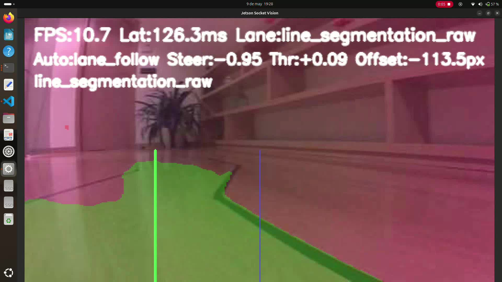
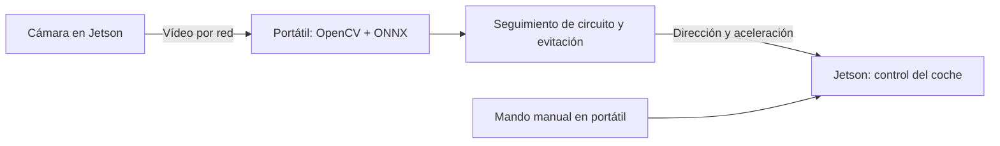

# Jetson Racer

Prototipo de conducción por visión para un coche con Jetson Nano: segmentación del circuito y obstáculos, cálculo de dirección y aceleración, y control manual desde un portátil.

**Python · OpenCV · PyTorch · ONNX · Jetson Nano**

[Demostraciones](videos/) · [Presentación](presentacion/presentacion.pdf) · [Entrenamiento](circuito_segmentation/README.md) · [Portfolio](https://r2deeznuts.github.io/)



*Captura de la grabación incluida en `videos/`. Los indicadores de la interfaz corresponden a ese instante; no son un benchmark.*

## Qué hace

El proyecto reúne la preparación del dataset, el entrenamiento de una U-Net con dos salidas (circuito y obstáculos), la exportación a ONNX y la integración de percepción, comunicación y control sobre el coche.

La Jetson captura el vídeo y acciona dirección y motor. **La inferencia y el cálculo de las órdenes se ejecutan en el portátil.** El sistema permite alternar el control automático con un mando manual y visualizar las máscaras y las órdenes calculadas.



## Resultado y límites

Se realizó una prueba integrada con captura de vídeo, segmentación, detección de cajas y envío de comandos al coche. Hay [vídeos de las pruebas](videos/) y un [guion de presentación](presentacion/guion_5min.pdf) con los resultados y limitaciones.

La cámara y la latencia del recorrido Jetson–portátil–Jetson condicionan el control. No se dispone de una evaluación formal de FPS, latencia o tasa de éxito; el proyecto documenta un prototipo experimental. La inferencia embarcada en Jetson queda como una vía de desarrollo.

## Puesta en marcha

### Requisitos

- Portátil Linux con Python 3, Bash y un emulador de terminal compatible (por ejemplo, GNOME Terminal).
- Jetson Nano con cámara operativa, OpenCV y el controlador `jetracer.nvidia_racecar.NvidiaRacecar` instalado y calibrado para el coche.
- Ambos equipos en la misma red, con acceso SSH por clave desde el portátil y los comandos `ssh` y `scp` disponibles.

### Preparar el portátil

```bash
git clone https://github.com/R2DeezNuts/jetson-racer.git
cd jetson-racer
python3 -m venv .venv
source .venv/bin/activate
python -m pip install -r socket_vision/vision/requirements.txt
export PYTHON_BIN="$PWD/.venv/bin/python"
```

La variable `PYTHON_BIN` selecciona el entorno para los lanzadores; debes definirla también al abrir una nueva sesión. El modelo ONNX y sus pesos externos están en `socket_vision/models/line_segmentation/` y deben conservarse juntos. Si OpenCV no puede cargar el modelo, el código contempla ONNX Runtime como alternativa, que requiere instalar `onnxruntime` en ese entorno.

### Configurar y arrancar

1. Ajusta IP de Jetson y portátil, usuario SSH, clave y directorio remoto en [global_config.json](socket_vision/global_config.json).
2. Revisa la [configuración de vídeo](socket_vision/conexion/config/default_config.json), los [parámetros de visión](socket_vision/vision/config/default_config.json) y la [calibración de control](socket_vision/control/config/default_config.json).
3. Reserva el directorio remoto para este proyecto: la sincronización sustituye su subcarpeta `socket_vision`.
4. Desde la raíz del repositorio, ejecuta:

```bash
bash socket_vision/conexion/scripts/main.sh
```

El lanzador sincroniza el runtime con la Jetson y abre las terminales de visión y control. El cliente manual usa `w/a/d/s`, espacio y `q`; consulta el [módulo de control](socket_vision/control/README.md). Al cerrar la última terminal de la sesión, el lanzador solicita detener los procesos remotos.

## Mapa del repositorio

| Ruta | Contenido |
| --- | --- |
| [socket_vision/conexion](socket_vision/conexion/README.md) | Transmisión de vídeo, sincronización y arranque |
| [socket_vision/vision](socket_vision/vision/README.md) | Inferencia ONNX, máscaras y decisión automática |
| [socket_vision/control](socket_vision/control/README.md) | Mando manual y protocolo de órdenes |
| [socket_vision/jetson](socket_vision/jetson/README.md) | Captura de cámara y actuación sobre el coche |
| [circuito_segmentation](circuito_segmentation/README.md) | Dataset, entrenamiento, predicción y exportación |
| [presentacion](presentacion/) | Presentación y guion en PDF y LaTeX |
| [videos](videos/) | Grabaciones de las pruebas |

Para reproducir el entrenamiento, sigue la [guía del modelo](circuito_segmentation/README.md). El runtime integrado del coche está en `socket_vision`; el ejemplo `jetson_runtime.py` del directorio de entrenamiento es una base experimental independiente.
